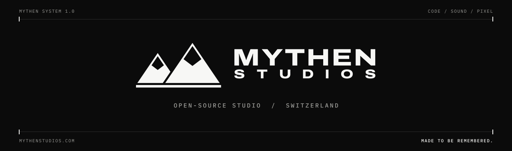
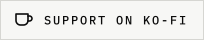

  <picture>
    <source media="(prefers-color-scheme: dark)" srcset="assets/banner-dark.svg">
    <source media="(prefers-color-scheme: light)" srcset="assets/banner-light.svg">
    
  </picture>

  
  
  
  

We build tools and plugins, make music and pictures - exactly the way we want them to be.
Everything we make ends up open on GitHub: look inside, use it, build on it. That's what it's for.

<picture>
  <source media="(prefers-color-scheme: dark)" srcset="assets/divider-dark.svg">
  
</picture>

## Featured: Sample Grabber

<table>
  <tr>
    <td valign="top" width="50%">
      <h3><a href="https://github.com/mythenstudios/sample-grabber">Sample Grabber</a></h3>
      
Pull audio from a link or a file, cut exactly the part you need, slice it across 16 pads and drag it straight into your DAW. BPM and key estimate, gain, pitch, speed and fades - and the external tools install themselves.

      

        
        
        
        
      

      <a href="https://github.com/mythenstudios/sample-grabber"><strong>View the project &rarr;</strong></a>
    </td>
    <td width="50%" align="center">
      
    </td>
  </tr>
</table>

## Tools of the trade

  
  
  
  
  
  
  
  
  
  

| | |
|---|---|
| **Audio plugins** | C++17 and JUCE 8, built with CMake. Cross-platform VST3 and standalone apps (Windows, Linux, macOS next), tested in FL Studio, Ableton Live and Bitwig. |
| **Prototyping** | New analysis ideas (tempo, key, slicing) start as Python prototypes and are checked against real audio before they are ported to C++. |
| **Streaming** | Plugins for OBS Studio, built against libobs. |
| **Web** | [mythenstudios.com](https://mythenstudios.com/) is built with Astro, HTML and CSS. |
| **Shipping** | Every push is built and tested on GitHub Actions: Windows and Linux builds, self-tests, installer. Docker where a clean, reproducible environment matters. |

Handcraft, open software or AI - we use whatever serves the work best. The result is what counts.

<picture>
  <source media="(prefers-color-scheme: dark)" srcset="assets/divider-dark.svg">
  
</picture>

### Support

Everything here is free and open source. If something of ours saves you time, a coffee helps us keep building.

<a href="https://ko-fi.com/mythenstudios">
  <picture>
    <source media="(prefers-color-scheme: dark)" srcset="assets/kofi-dark.svg">
    
  </picture>
</a>

